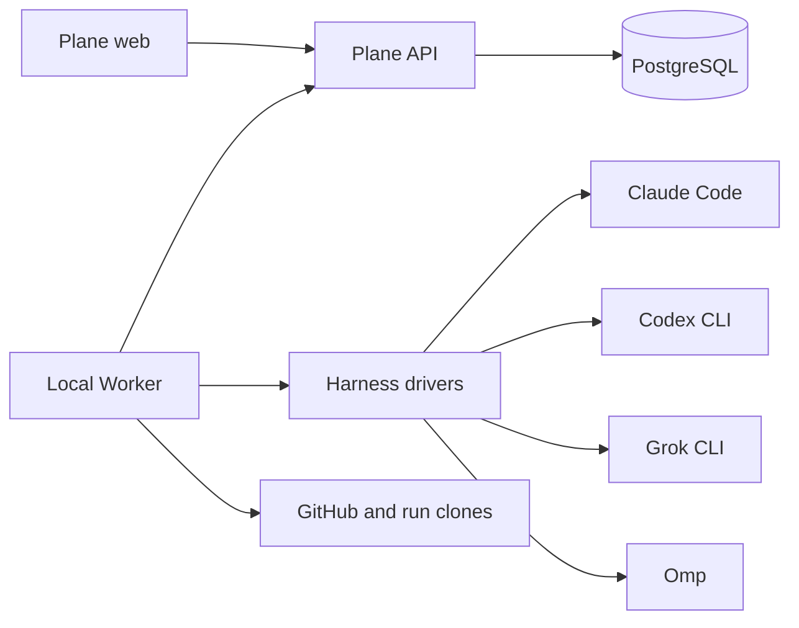
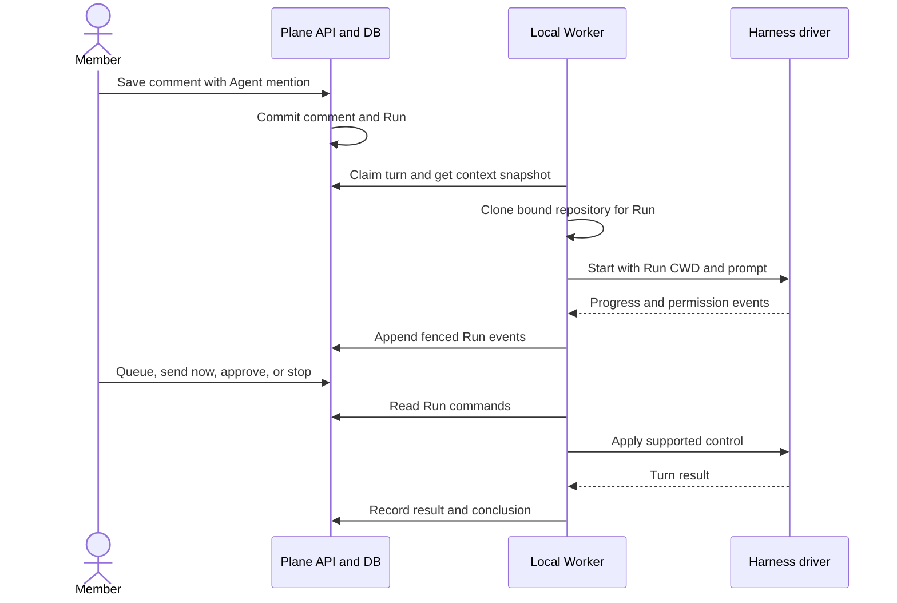

# Architecture Spine — Local CLI agents

## Design Paradigm

Plane API and PostgreSQL form the control plane.
One local Worker is the execution plane.
The Worker uses one driver for each Harness and maps vendor events into one Plane Run contract.
The Run contract does not depend on a CLI process, vendor session ID, or execution host.

## Invariants and Rules

### AD-1 — Plane owns Run state [ADOPTED]

- **Binds:** FR-8–FR-15, FR-19, FR-22.
- **Prevents:** The Worker and browser creating different histories or permission states.
- **Rule:** Plane API is the only writer of Run state, queued user commands, permission decisions, and ordered timeline events.
  The Worker claims work and posts observations through authenticated API commands.
  Each Run command has a stable idempotency key; each event has a Run-local sequence and a source event key.

### AD-2 — A mention fixes the Run's identity and context [ADOPTED]

- **Binds:** FR-7, FR-8, FR-20–FR-23.
- **Prevents:** A tagged Agent reading the wrong issue, repository, or conversation.
- **Rule:** The comment write and Run creation commit together.
  The Run stores the workspace, project, issue, Agent, requester, trigger comment, and repository binding IDs.
  Plane API builds a versioned context snapshot containing the project identity and summary, issue identity, title, description, state and URL, the ordered prior issue comments visible to the Agent's requester, the exact trigger comment, and the bound repository identity and base ref.
  Channel mentions, if supported by a later surface, use the same envelope with channel identity and authorized ordered channel messages instead of issue fields.
  The Worker formats that snapshot into the first prompt and adds later issue changes and same-Run messages as ordered deltas.
  The prompt identifies the source, author, timestamp, and record ID of each included item, and separates system instructions from member content.
  Long history may be omitted from the prompt only with an omission count and an authorized retrieval path.

### AD-3 — A lease fences Worker ownership

- **Binds:** FR-8, FR-11, FR-19, FR-22.
- **Prevents:** Two pickups, a stale Worker, or a retry from running the same turn twice.
- **Rule:** The Worker polls Plane API and claims a Run turn with a lease generation and expiry.
  Every Worker mutation carries the current generation; Plane rejects mutations from an older generation.
  A lost lease marks the Run stale, but does not delete its clone or history.
  Retry creates a new lease only after the Worker reconciles or stops any prior Run process.
  It resumes from the last committed event cursor and must not repeat an action with possible side effects without a new user command.

### AD-4 — Each Harness declares verified interaction capabilities [ADOPTED]

- **Binds:** FR-5, FR-6, FR-9, FR-12, FR-15, FR-22.
- **Prevents:** One Harness silently losing messages or exposing a control it cannot perform.
- **Rule:** A Harness driver implements connect and capability check, model discovery, start or resume, send, event stream, cancel, permission response, and shutdown where supported.
  It reports capabilities such as midturn input and native session resume separately.
  The Worker maps each driver's output into common message, thought, tool, plan, question, permission, error, and terminal events.
  Plane shows a control only when its behavior can be delivered by that driver or by the Run control plane.
  V1 has four drivers: Claude Code, Codex CLI, Grok CLI, and Omp.
  A driver is Connected only after a local probe verifies authentication, available model reporting, one resumed follow-up, progress events, interruption, permission enforcement, and recovery for its installed version.
  Unsupported native controls are false capabilities; the Plane queue and cancel-then-next-turn path still provide the Run-level interaction in AD-5.

| Harness | V1 control path | Native midturn input | Model source | Proof still required |
| --- | --- | --- | --- | --- |
| Claude Code | CLI streaming JSON input and output, session resume, permission prompts | Candidate; probe required | CLI or local SDK session model report; probe required | Correlated permission response, model list, midturn delivery, recovery |
| Codex CLI | Local app-server protocol with thread and turn commands, events, and approvals | Candidate via `turn/steer`; probe required | `model/list` | Turn steering, approval response, process recovery |
| Grok CLI | Headless streaming JSON turns with session resume; Plane queues later turns | No native midturn path verified | `grok models`; probe required | Permission pause and resume, safe cancellation, event fidelity |
| Omp | Stdio RPC with prompt, steer, follow-up, abort, session and UI-response commands | Candidate via `steer`; probe required | `get_available_models` | Permission and question mapping, restart recovery |

The control paths above are source-backed candidates, not a claim that conformance tests already passed.
If a probe cannot satisfy the common Run behavior, that Harness stays in Connection failed with the missing action named; an epic must resolve the gap before that Harness is enabled for v1.
The source references are the [Claude Code CLI guide](https://code.claude.com/docs/en/cli-usage), [Codex app-server protocol](https://github.com/openai/codex/blob/main/codex-rs/app-server/README.md), [Grok headless CLI guide](https://docs.x.ai/build/cli/headless-scripting), [Grok CLI reference](https://docs.x.ai/build/cli/reference), and [Omp RPC protocol](https://github.com/can1357/oh-my-pi/blob/main/docs/rpc.md).

### AD-5 — Plane controls message order and interruption [ADOPTED]

- **Binds:** FR-12, FR-13, FR-15, FR-22.
- **Prevents:** A follow-up entering the wrong turn, being sent twice, or disappearing on Stop.
- **Rule:** Plane stores each panel message before Worker delivery and records queued, dispatching, accepted, or cancelled state.
  The Worker delivers queued messages in order when the Harness can accept them.
  Send now uses native midturn input only when the driver verifies it.
  Otherwise the Worker cancels the current turn, waits for a terminal or timeout, and starts the selected message as the next turn in the same Run.
  Stop cancels the turn and clears only undelivered queue items; a later reply continues the same Run.

### AD-6 — A Run is stable across Harness processes

- **Binds:** FR-12, FR-13, FR-15, FR-16, FR-17, FR-22.
- **Prevents:** A process restart or Q&A-to-code move from creating a new user conversation.
- **Rule:** Plane Run ID is the conversation identity.
  The Worker stores a driver session reference when one exists, but it can start a new driver session from the durable Run transcript and context snapshot.
  A change from read-only clone to code Worktree may replace the driver process and session without replacing the Plane Run.
  The Run records the clone path, optional Worktree path, and active workspace kind.
  Escalation switches the active workspace from clone to Worktree before code execution.
  All later prompts and recovery use that active workspace.
  The Worker reports any unrecoverable turn as a visible error and does not claim that lost work completed.

### AD-7 — Each mention gets one fresh repository clone [ADOPTED]

- **Binds:** FR-3, FR-4, FR-16–FR-18, FR-20.
- **Prevents:** Cross-Run file state, use of the deployment checkout, and work on the wrong repository.
- **Rule:** The Worker clones the Run's bound remote into a path derived from its Run ID under a configured root outside the Plane deployment checkout.
  Q&A executes in that clone under a read-only OS boundary.
  Code work uses a Worktree and branch owned by that clone and a bounded Docker sandbox.
  The Worktree becomes the active CWD for all later messages in that Run.
  Stop and stale recovery retain both clone and Worktree.
  The Worker verifies the remote and path before launch, resume, and push.
  The Q&A OS boundary must deny writes outside the Run clone and deny writes inside it until the member grants Code work; the Code sandbox mounts only the active Worktree as writable and grants no default-branch push credential.
  A Harness's own approval or sandbox switch is an additional control, not the only boundary.

### AD-8 — Plane grants rights; the sandbox enforces them [ADOPTED]

- **Binds:** FR-14, FR-16–FR-18, FR-23.
- **Prevents:** A Harness bypassing a UI permission or writing outside its Run.
- **Rule:** Each proposed effect creates a durable Plane permission request with a request ID, Run, turn, lease generation, action, normalized scope, proposed command or effect hash, and risk text.
  Plane records allow-once, allow-for-Run, or deny decisions against that request with actor and time.
  Allow once applies only to that request; allow for Run applies only to later requests within the approved action and scope.
  The Worker may execute a write or access escalation only after it reads a request-linked grant for the current lease and Run.
  Driver permission prompts map to this decision flow, but driver prompts alone are not the enforcement boundary.
  OS and Docker restrictions remain active even when a driver has its own approval mode.
  For an approved additional-file write, Docker produces the bounded content in its private execution boundary.
  The trusted Worker can publish that exact content on the Host through pinned no-follow descriptors after it rechecks the matching consumed grant and current lease.
  This publication step is an explicit exception to executing a file effect entirely inside Docker, accepted by the member on 2026-09-28.
  It grants the Harness no Host descriptor, parent-directory access, or external bind mount.
  Preparation and publication results must survive restart; recovery reports retained state without writing the target again.
  Untrusted issue and comment text is task data, not Worker policy.

### AD-9 — GitHub integration and repository binding have one owner

- **Binds:** FR-1–FR-4, FR-18.
- **Prevents:** A project picker, clone, and pull request using different repositories or credentials.
- **Rule:** Plane API must own the Agent GitHub connection and one repository binding per project, keyed by GitHub repository identity.
  The Worker receives the bound remote and uses Mini-held git credentials for clone and push; GitHub grants are not copied into prompts.
  The new Agent integration creates pull requests through Plane API and records the draft PR identity on the Run; current CE repository-sync records do not provide this path.
  Draft creation is the default and the Agent never merges.
  Plane owns the branch-format enum shared by settings, API, and Worker: `agent/<issue-identifier>-<run-short-id>` (default) or `agent/<project-identifier>/<issue-identifier>-<run-short-id>`.
  The Run ID suffix prevents two mentions on the same issue from taking the same branch; resuming a Run keeps its branch.
  An absent, revoked, or ambiguous binding blocks Harness launch and asks the member to resolve it.

### AD-10 — The browser reads a durable event cursor

- **Binds:** FR-8–FR-11, FR-19.
- **Prevents:** Lost timeline entries after a refresh or a disconnected live view.
- **Rule:** Run card and panel read Plane API projections from the event log.
  The panel requests events after its last Run-local sequence and reconciles by event ID.
  V1 uses short cursor polling while a Run is active; transport can change without changing event identity or order.
  Activity shows the Run card and conclusion, while intermediate events stay in the panel.

### AD-11 — Code capacity is a durable waiting state

- **Binds:** FR-16, FR-17, FR-19.
- **Prevents:** A full Mini starting an extra code container or losing a Run that waits for capacity.
- **Rule:** Plane records Code jobs that await capacity in a visible waiting state, ordered by durable enqueue time and Run ID.
  The Worker must obtain a bounded Code slot before it creates a Docker sandbox, and it releases that slot only after the container stops.
  A full pool leaves the Run waiting; it does not reject the Run or start another container.
  Lease recovery reconciles a stale slot with the actual container before reassigning it.

## Structural Seed

The Mac Mini runs Plane API, PostgreSQL, the Worker, local Harness processes, and bounded Docker code jobs.
The Worker calls Plane over localhost.
People reach Plane through Tailscale.
No public Worker callback is required.

## Capability to Architecture Map

| PRD area | Owner | Governing decisions |
| --- | --- | --- |
| GitHub connection and project binding | Plane API integration and Worker git operations | AD-7, AD-9 |
| Harness connection, models, and mentions | Plane API and Harness drivers | AD-2, AD-4 |
| Run card, panel, and durable timeline | Plane API and web | AD-1, AD-3, AD-10 |
| Conversation, queue, steering, and recovery | Plane API and Worker | AD-3–AD-6 |
| Permission and isolation | Plane API and Worker sandbox | AD-7, AD-8 |
| Context delivery | Plane API snapshot and Worker prompt formatter | AD-2, AD-6 |
| Draft pull request | Worker git operations and Plane GitHub integration | AD-7–AD-9 |
| Code capacity and waiting | Plane API and Worker | AD-3, AD-11 |

## Deferred

- Exact endpoints, tables, indexes, and event payload fields belong to the epics, under AD-1 through AD-3.
- Poll interval and retention limits are operational settings; the event cursor contract is fixed by AD-10.
- Driver command flags and parser details follow the required connection probe for each installed Harness; AD-4 fixes the transport candidates and conformance contract.
- Remote execution is a later delivery path; it must use the same Plane Run and event contract.
- Model IDs come from each verified Harness connection and are not pinned in the architecture.

## Open probes before four-Harness delivery

- Prove Claude Code's model reporting and permission response through the local CLI or SDK without requiring a separate API credential.
- Prove Grok CLI can stop at a permission boundary and resume a denied or approved tool action without a hidden write; headless turns and hooks alone do not establish that guarantee.
- Prove Q&A OS write restrictions for each installed Harness and Docker mount, network, process, and credential restrictions for Code jobs on the Mac Mini.
- Test denied writes within and outside the Run clone, symlink or path escape attempts, and network escalation before declaring the Q&A boundary safe.
- Prove each driver passes AD-4's local conformance checks on the installed version before showing Connected.
